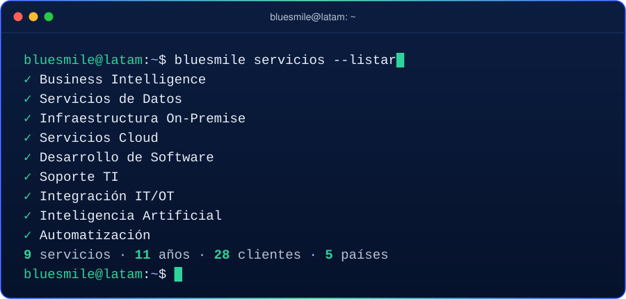

  
  
  
  

 

  

## 🏢 Quiénes somos

**BlueSmile Technology** es una consultora TI chilena. Automatizamos, migramos a la nube y operamos
plataformas críticas para **banca, minería, telecomunicaciones y sector público**, con un equipo
global presente en diversos países.

Implementamos, administramos y damos soporte a las plataformas sobre las que corre tu negocio,
**de la infraestructura a los datos**.

## 🚀 Proyectos open source

<table>
  <tr>
    <td width="50%" valign="top">
      
      

        
        
        
      

      

        <a href="https://github.com/bluesmilecl/AiSdk.Net"><b>Repositorio</b></a> ·
        <a href="https://www.nuget.org/packages/AiSdk.Net">NuGet</a> ·
        <a href="https://github.com/bluesmilecl/AiSdk.Net/blob/main/docs/wiki/es-Inicio.md">Documentación</a>
      

    </td>
    <td width="50%" valign="top">
      
      

        
        
        
      

      

        <a href="https://github.com/bluesmilecl/framework-gob"><b>Repositorio</b></a> ·
        <a href="https://framework-gob.vercel.app">Demo en vivo</a> ·
        <a href="https://framework-gob.vercel.app/chat/">Maqueta de chat IA</a>
      

    </td>
  </tr>
</table>

## 🧩 Qué hacemos

<table>
  <tr>
    <td width="33%" valign="top">
      <h4>⚙️ Plataformas y automatización</h4>
      Contenedores, automatización, virtualización y monitoreo. 
      OpenShift · Ansible · Virtualización · Monitoreo
    </td>
    <td width="33%" valign="top">
      <h4>☁️ Nube</h4>
      Infraestructura y plataformas en la nube pública y privada. 
      Cloud computing · Migración a la nube
    </td>
    <td width="33%" valign="top">
      <h4>📊 Datos</h4>
      Ingeniería de datos, analítica e inteligencia de negocio. 
      Business Intelligence · Data Warehouse · Dashboarding
    </td>
  </tr>
  <tr>
    <td width="33%" valign="top">
      <h4>🛠️ Servicios y consultoría</h4>
      Soporte, proyectos y desarrollo a la medida de tu negocio. 
      Consultoría Linux · Open Source · Transformación digital
    </td>
    <td width="33%" valign="top">
      <h4>💬 Contactabilidad</h4>
      Canales y herramientas para comunicarte con tus clientes de forma oportuna. 
      Contactabilidad omnicanal
    </td>
    <td width="33%" valign="top">
      <h4>🖥️ Hardware</h4>
      Equipos para tu centro de datos y para tu equipo de trabajo. 
      Venta de hardware
    </td>
  </tr>
</table>

## 🛠️ Stack tecnológico

<b>Desarrollo</b>

  

<b>Plataformas y nube</b>

  

## 🤝 Confían en nosotros

  <b>BANCA Y FINANZAS · MINERÍA · TELECOMUNICACIONES · SECTOR PÚBLICO · AUTOMOTRIZ</b>

  BHP · Codelco · BancoEstado · Claro · Gobierno de Chile · Cencosud · BCP · Interbank · Banco General ·
  BAC Credomatic · LarrainVial · Sonda · Cable &amp; Wireless · Ministerio de Obras Públicas ·
  Farmacias Ahumada · Gildemeister · Inchcape · Banco BHD

  
  
  

  Respaldados por IBM · Amazon Web Services · Microsoft · Oracle · Hewlett Packard Enterprise · Nutanix · Veeam · Pure Storage · Rackspace · Trilio · Nagios

## 🐍 Actividad

  <picture>
    <source media="(prefers-color-scheme: dark)" srcset="https://raw.githubusercontent.com/bluesmilecl/bluesmilecl/output/snake-dark.svg">
    <source media="(prefers-color-scheme: light)" srcset="https://raw.githubusercontent.com/bluesmilecl/bluesmilecl/output/snake-light.svg">
    
  </picture>

## 📫 Hablemos

  ¿Quieres conocer más acerca de nuestros servicios? 
  Escríbenos a <a href="mailto:contacto@bluesmile-it.com"><b>contacto@bluesmile-it.com</b></a> o visita <a href="https://bluesmile-it.com"><b>bluesmile-it.com</b></a>.

